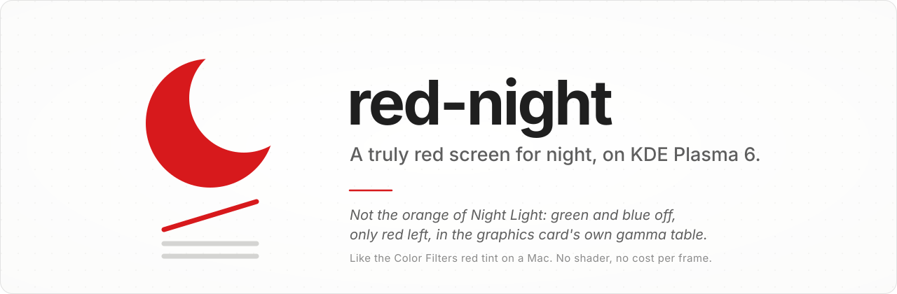
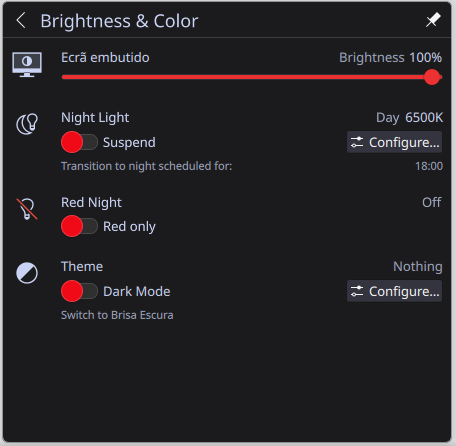

<p align="center">
  <picture>
    <source media="(prefers-color-scheme: dark)" srcset="docs/images/banner-dark.svg">
    
  </picture>
</p>

<p align="center">
  <a href="#the-switch">The switch</a> ·
  <a href="#quick-start">Quick start</a> ·
  <a href="#use">Use</a> ·
  <a href="#how-it-works">How it works</a> ·
  <a href="#limits">Limits</a>
</p>

<p align="center">
  
  
  
  
</p>

---

**red-night turns your screen truly red for the night.** Green and blue are switched off and only the red channel is
left, at the brightness you choose. Plasma's Night Light stops at about 1000 K, which is still orange: white text is
still a warm white, and the blue and green that wake you up are still there. This is the other thing, the one macOS
has under Color Filters (a red Color Tint at 100 %, with Reduce White Point): white becomes red, and nothing else is
lit.

It is one switch in the tray's Brightness and Color popup, under Night Light, and a command. It costs nothing per
frame: the ramp lives in the graphics card's own gamma table, not in a shader. While it is on, the link and activity
LEDs of the wired network ports are off too.

<p align="center">
  
</p>
<p align="center"><sub>Screenshots are taken before the gamma table, so the picture shows the screen as it would look with the filter off.</sub></p>

## The switch

Click the brightness icon in the system tray. Under Night Light there is a **Red Night** row with a switch like
Night Light's: it turns the filter on and off at the last level, shows On or Off and the level, and follows changes
made elsewhere (the schedule, the command), polling while the popup is open.

Everything else is the command, and the menu entry *Red Night* (right-click it for On, Off, Brighter, Dimmer).

## Quick start

**You need** KDE Plasma 6 on **Wayland**, with colour management (the ICC profile setting in Display Configuration),
and:

- Python 3 with [PySide6](https://pypi.org/project/PySide6/), for building the tray switch (`pyside6` on Arch);
- Little CMS 2 (`liblcms2.so.2`), `kscreen-doctor`, `kwriteconfig6` and `notify-send`, which a Plasma desktop already
  has.

Tested on Plasma 6.8.1 (KWin and powerdevil 6.8.1) on Arch Linux, with an amdgpu laptop panel.

```sh
git clone https://github.com/Di0go/red-night.git
cd red-night
./install.sh
```

It installs, for the current user, and asks for your password once (`pkexec`) for the network port LEDs; with
`./install.sh --no-leds` it needs no root and leaves them alone:

| What | Where |
|---|---|
| The command | `~/.local/bin/red-night`, a symlink to this checkout |
| The menu entry "Red Night" | `~/.local/share/applications/red-night.desktop` |
| The Red Night switch in the tray | `~/.local/share/plasma/plasmoids/rednight.brightness/` |
| The guard for that switch | `~/.config/systemd/user/plasma-plasmashell.service.d/red-night-tray.conf`, `red-night-tray.path`, `red-night-tray.service` |
| The port LEDs, as root | `/etc/udev/rules.d/90-red-night-lan-leds.rules`, `/etc/modules-load.d/red-night.conf` ([`tools/lan-leds`](tools/lan-leds)) |
| The port LEDs at login | `~/.config/systemd/user/red-night-leds.service` |

The checkout is used in place, so keep it where it is. `./install.sh` also removes the global shortcuts an older
version registered; there are none now.

### Uninstall

```sh
./uninstall.sh
```

It puts every output's colour profile and the network port LEDs back, puts the stock Brightness and Color back in
the tray, and removes the LED rule (asking for your password), the schedule timer, the guard, the menu entry, the
command, the generated profiles and the settings. The checkout itself is left in place.

## Use

```sh
red-night toggle
red-night on [LEVEL]             # LEVEL 1-100, the red brightness; default is the last used (60 at first)
red-night off                    # every output back the way it was
red-night level up|down|N        # steps: 2 5 10 20 30 … 100
red-night status
red-night state                  # one line for scripts: on|off LEVEL
red-night schedule 22:00 07:00   # a systemd user timer; catches up after sleep or boot
red-night schedule off
red-night leds                   # port LEDs off if it is on, as they were if not (what runs at login)
```

The tray switch has its own command, for when something looks wrong:

```sh
red-night-tray status    # which powerdevil the switch was built from, what the tray shows, the guard
red-night-tray check     # what the guard runs: rebuild if powerdevil changed, or go back to stock
red-night-tray remove    # the stock Brightness and Color back, the copy and the guard removed
red-night-tray install   # and again
```

## How it works

### The red: an ICC profile's VCGT

Plasma 6 colour management lets each output use an ICC profile, and KWin honours the profile's **VCGT** (video card
gamma table). `red-night` writes an ordinary sRGB profile, with Little CMS, whose VCGT ramps are:

- red: identity × level / 100
- green and blue: flat at 0

and sets it on every enabled output with `kscreen-doctor`, after writing down the colour profile source and ICC path
each output had, which `red-night off` puts back. KWin loads the ramp into the CRTC's hardware `GAMMA_LUT` (seen on
amdgpu), so:

- **there is no cost per frame**: no shader pass, no extra work for the compositor;
- **everything is covered**: the cursor plane, fullscreen video and direct scanout all go through the CRTC's table;
- **Night Light is left alone**: its setting is not changed.

### The switch: a copy of the stock applet

Brightness and Color is the stock applet `org.kde.plasma.brightness`, from powerdevil. Plasma 6 compiles its QML into
`/usr/lib/qt6/plugins/plasma/applets/org.kde.plasma.brightness.so` and prefers that copy, so a package with the same id
in `~/.local/share/plasma/plasmoids/` is ignored. (It only wins when its metadata has no `Id`, and then the applet's id
becomes `metadata`, which breaks translations, settings and the tray.)

So `red-night-tray install`:

1. reads the QML out of the **installed** `.so` (with PySide6, in a separate process);
2. builds a copy under its own id, **`rednight.brightness`**, with [`tray/RedNightItem.qml`](tray/RedNightItem.qml)
   added under the Night Light row and the stock translations kept;
3. compiles the copy to check it;
4. swaps it into the tray in place of `org.kde.plasma.brightness`, live, through plasmashell's scripting interface, with
   no restart.

### The guard: Plasma updates

The copy uses powerdevil's private QML plugin, so it must match the installed powerdevil, and a Plasma update can
change it under the copy. The guard, `red-night-tray check`, runs:

- before every plasmashell start (a drop-in on `plasma-plasmashell.service`);
- a few seconds after the applet's files change (a systemd path unit on the two `.so` files), that is, after a
  `pacman -Syu`.

If powerdevil changed, it rebuilds the copy from the new files and checks that it compiles. If that fails, for any
reason, it puts the stock applet back in the tray, removes the copy, writes why to
`~/.local/state/red-night/tray-error` and sends a notification. Either way you keep the brightness slider.

### The network port LEDs

Drivers like `r8169` run the port LEDs in hardware and expose them as `/sys/class/leds/<port>-N::lan`, driven
through the `netdev` trigger: activating it reads each LED's mode (link at which speeds, activity) from the hardware,
and every mode at 0 switches the LED off. When the filter goes on, `red-night` writes down each wired port LED's
trigger and mode in `~/.local/state/red-night/lan-leds` and sets every mode to 0; when it goes off, it writes them
back. The udev rule hands those files to you, so this needs no password at the switch, and `red-night-leds.service`
applies it again at login, because the hardware goes back to its own default at boot. Wi-Fi LEDs and every other LED
are left alone.

### Tests

```sh
tests/profile-test.py   # generates profiles and reads them back with lcms: red = x·level, green = blue = 0
tests/screen-test.sh    # THE REAL SCREEN, ~3 s red: on, brighter, dimmer, off, reading the hardware LUT; always reverts
tests/tray-test.py      # the guard, offline in temporary folders: build, swap, rebuild after an update, back to stock
tests/lan-leds-test.py  # the port LEDs, offline on a fake /sys/class/leds: off, back exactly as before, after a reboot
tests/crtc-lut.py       # print the GAMMA_LUT the kernel is scanning out right now (modetest, no root)
```

`crtc-lut.py` takes the DRM driver as its argument (`amdgpu` by default).

## Limits

- **Wayland and Plasma 6 only.** It needs KWin's colour management and a per-output ICC profile. KWin's nested
  `--virtual` backend reports its outputs as "ICC incapable", so the effect can only be tried on a real DRM output.
- **HDR outputs** use a separate HDR ICC slot, which red-night does not touch.
- **A monitor plugged in while it is on** stays normal until you toggle again (or run `red-night on`).
- **A monitor unplugged while it is on** keeps the red profile in KWin's memory. Run `red-night off` after plugging it
  back in.
- **It survives a reboot**, because KWin keeps the output settings: it stays on until you turn it off or the schedule
  does.
- **If the popup shows an error instead of the sliders**, for example because plasmashell was restarted by hand right
  after an update, before the guard ran, run `red-night-tray check` or `red-night-tray remove`.
- **Tested on one machine**, an amdgpu laptop panel. Other drivers and external monitors are untested.
- **Port LEDs**: only those a driver exposes as `*::lan` with `netdev` hardware offload (tested with `r8169`). Their
  colour is fixed by the part; they can only be switched off.

## License

[MIT](LICENSE)
